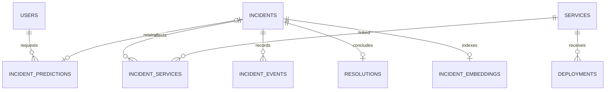

# Prediction design

## Workflow and storage

Next.js uses the existing session and role checks for predictions. The browser sends draft intake fields to a route handler, which reads timestamped PostgreSQL context and runs a versioned model artifact in the server process. Training is an offline Node.js task and can run from an exported or imported dataset. The application uses one PostgreSQL database and keeps the existing pgvector retrieval workflow.

A preview stores its feature snapshot, model version, score time, input hash, and owner. The create transaction binds at most one preview to a new incident. Preview ownership, freshness, and a hash match are checked together. Expired previews are removed during scoring. The existing incident creation route still works when predictions are unavailable.

## Data dictionary

| Field | Source and availability |
| --- | --- |
| Intake wording | Title and description from the report. Used as a set of case-insensitive word tokens. |
| Affected service count | Distinct services selected by the reporter. |
| Prior incidents | Earlier incidents touching the primary service in the prior 30 days. |
| Recent deployments | Deployment records for the primary service in the prior 24 hours. |
| Prior resolution minutes | Average of durations from incidents touching the primary service that resolved before the cutoff. Missing history is represented as null. |
| Hour and weekend | UTC calendar features at intake. |
| Severity | Reporter-selected severity at creation. |
| Cause | Category in the resolution record. Uses the same vocabulary as the resolution form. |
| Duration | Minutes from incident creation to resolution; open cases have a missing outcome. |

Historical export prefers the stored score-time features where present and reconstructs other cases from data before creation. Reconstructed features assume database event timestamps reflect when the information first became available. Review backfilled deployments or revised historical records before training. Resolution descriptions, investigator notes, and knowledge search embeddings are excluded from features.

## Models and evaluation

Compare a majority-class or median-duration baseline with uniform and inverse-distance nearest neighbors. Fixed feature distances use word overlap, scaled count differences, and cyclical hour distance. Chronological splits are 60% development, 20% validation, and 20% test by distinct intake time. Resolution outcomes must be available before a split boundary to train or select a model at that boundary. The held-out test period is used for the final report and serving readiness. The report includes macro F1, per-class precision and recall, confusion matrices in the API response, and MAE/RMSE for duration.

For historical models, predictions are withheld for tasks with low evaluation support or no held-out improvement over the baseline. Results use conditional nearest-neighbor votes and estimates, with no calibrated percentages. The intake panel reruns the selected models while omitting one input at a time and lists inputs that changed the leading classification or shifted duration by at least ten minutes. This is sensitivity to inputs, rather than causal attribution.

Incomplete outcome records reduce the labeled sample for cause and duration. Performance on resolved cases can differ from performance on incidents that remain open. Unknown services fail intake validation. Sparse context is handled with counts of zero and a nullable historical mean. Model quality may change with service and deployment practices, so track later outcomes separately before retraining.
